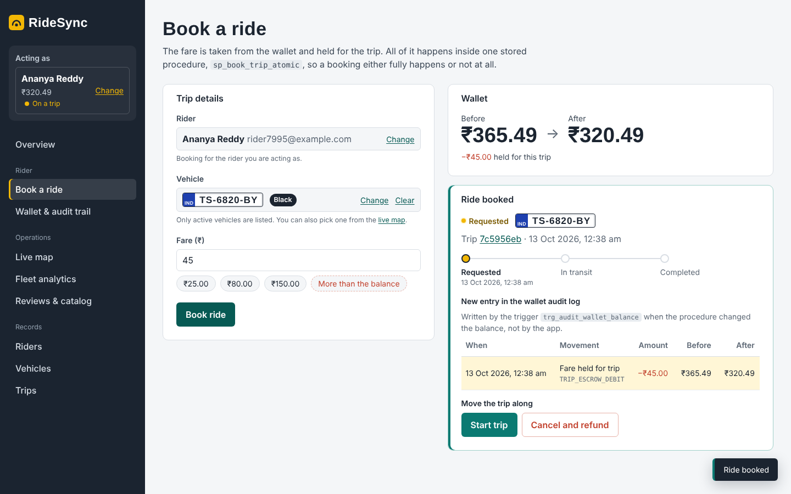
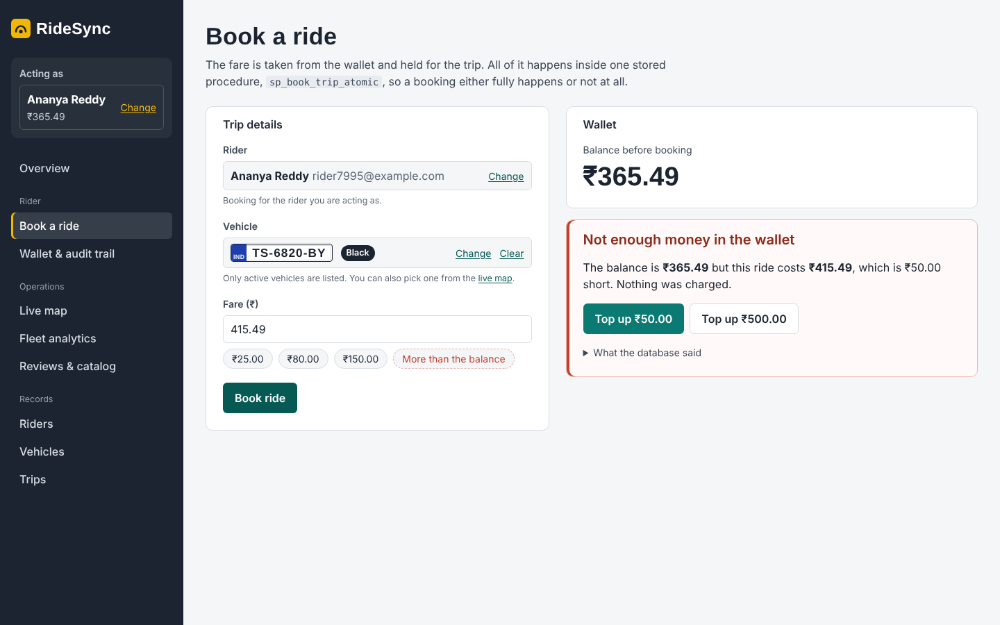
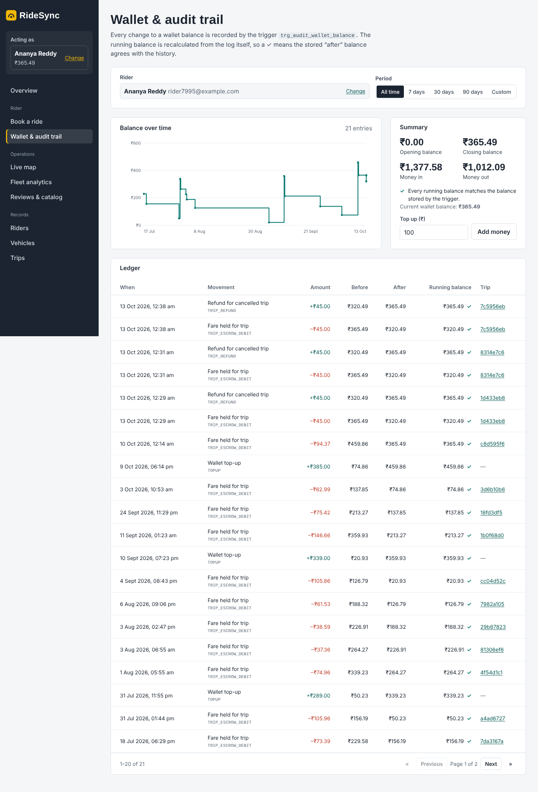
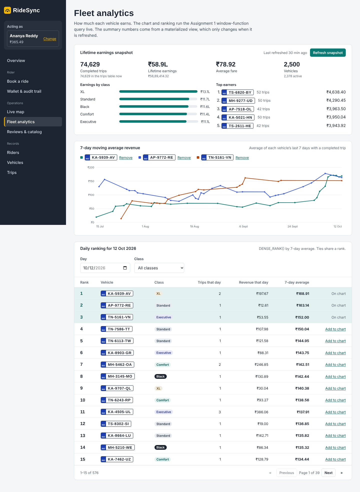
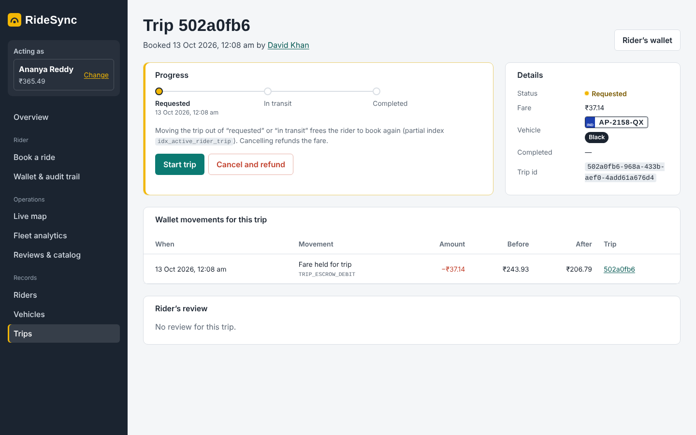
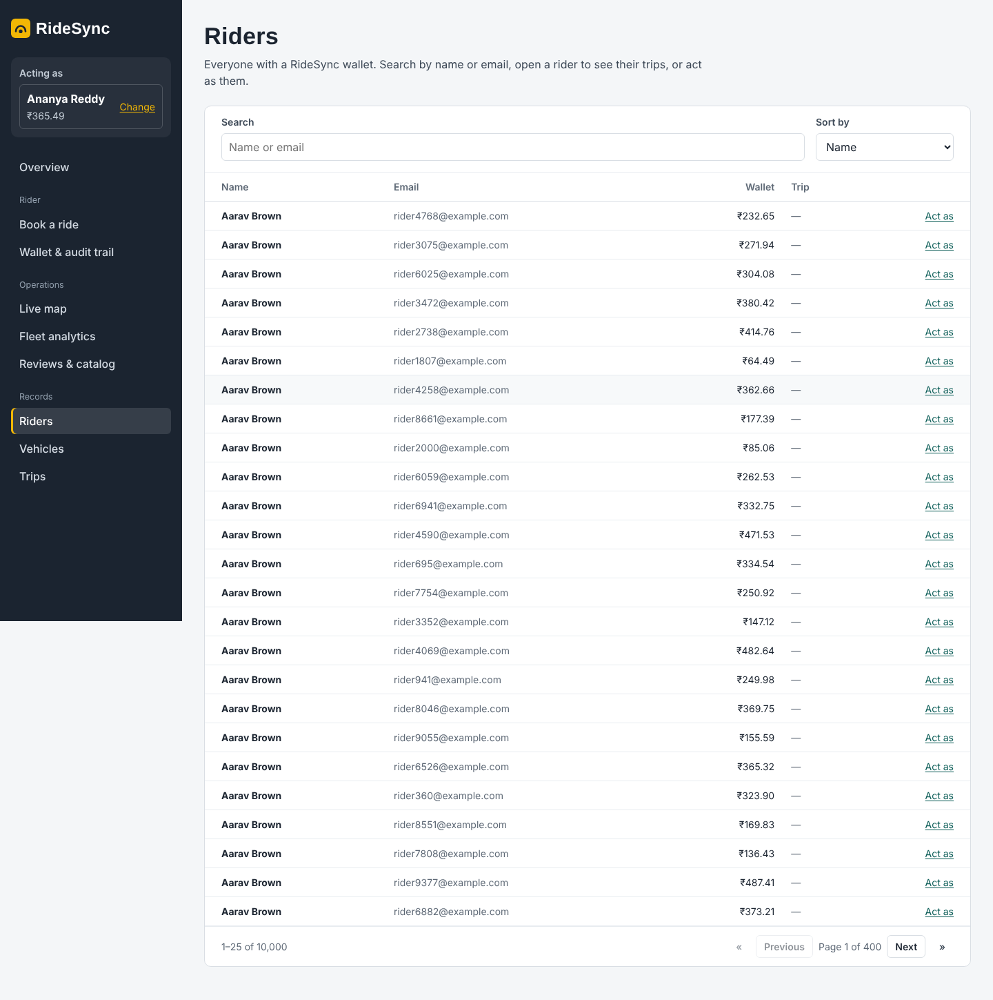

# RideSync Console: Assignment 1B Front End

A web front end for the inherited **P2 RideSync** database (PostgreSQL + MongoDB). Through a browser, a rider can book a trip, see their wallet history, and top up. An operations user can watch nearby vehicles on a live map, compare vehicle revenue, refresh the earnings snapshot, and read rider reviews.

All four Assignment 1 workflows run in the database (stored procedures, triggers, views, window functions, `$geoNear`, and `$facet`); the API in between is deliberately thin.
We inherited the P2 RideSync backend from Assignment 1 (PostgreSQL + MongoDB) and ran its schema, seeders, procedures, and pipelines locally before building anything. The full story — what worked, what didn't, what we changed, and what we'd suggest to the original authors — is in [`docs/handover_note.md`](docs/handover_note.md). The API surface we designed before writing any UI code is in [`docs/api_endpoints.md`](docs/api_endpoints.md).

| | |
|---|---|
| **Team** | Team 18 |
| **GitHub repository** | https://github.com/manish0222/Team18_a1b (fork of `Neelesh-Srivastava435/2026201031_a1`; Assignment 1 history kept) |
| **Final commit hash** | `<FILL: run git rev-parse HEAD after final push>` |
| **Demo video (≤ 5 min)** | `<FILL: video link>` (script: [docs/demo_script.md](docs/demo_script.md)) |



---

## Contents

0. [What we inherited and verified](#0-what-we-inherited-and-verified)
1. [Run it](#1-run-it)
2. [Design — who uses it, and what it looks like](#2-design--who-uses-it-and-what-it-looks-like)
3. [Screens and how they map to the workflows](#3-screens-and-how-they-map-to-the-workflows)
4. [Tests](#4-tests)
5. [Technology choices](#5-technology-choices)
6. [Architecture](#6-architecture)
7. [Assumptions](#7-assumptions)
8. [Changes to the inherited database](#8-changes-to-the-inherited-database)
9. [Repository layout](#9-repository-layout)
10. [Contribution table](#10-contribution-table)
11. [Known limitations](#11-known-limitations)
12. [Summary](#12-summary)
13. [Handover note](docs/handover_note.md)
14. [API endpoints](docs/api_endpoints.md)

---

## 0. What we inherited and verified

Before writing any front-end code, we completed the assignment's Step 1:

- **Ran the inherited backend locally.** We followed the original README, applied the schema (`sql/01`–`06`), loaded MongoDB indexes, ran both Python seeders, and confirmed the four Assignment 1 workflows (booking, window analytics, `$geoNear`, `$facet`) run as documented. The performance evidence in `performance/` matched what we reproduced.

- **Wrote a handover note.** [`docs/handover_note.md`](docs/handover_note.md) lists what worked, what did not (eleven specific issues, including a broken AFTER trigger, an empty seeded audit log, missing SQLSTATEs, random UUIDs in the MongoDB seeder, and a `const db` ReferenceError), what we changed and why, and suggestions for the original authors. Every change is marked `[A1B]` in the source file.

- **Sketched the API before building the UI.** [`docs/api_endpoints.md`](docs/api_endpoints.md) lists every endpoint, its inputs, and its outputs, including how each custom SQLSTATE (`RS001`–`RS007`) maps to an HTTP status and code.

The `docs/handover_note.md` and `docs/api_endpoints.md` files were written before the front end, not after.

## 1. Run it

Choose the setup path that matches your machine. All three paths are intended to reach the same app; use **one** path rather than combining them.

### Option A — One-command bootstrap (recommended for Ubuntu and macOS)

Designed for a fresh **Ubuntu 22.04/24.04** or **macOS** machine with Git and internet access. The bootstrap scripts are intended to install/configure the prerequisites, write `.env`, create the database, run the schema and seeders, back-fill the wallet ledger, and install dependencies. The first setup may take around **15–25 minutes**, depending on the machine and network.

```bash
git clone https://github.com/manish0222/Team18_a1b.git
cd Team18_a1b

# Ubuntu
sudo bash scripts/bootstrap.sh

# macOS (no sudo needed)
bash scripts/bootstrap.sh
```

`scripts/bootstrap.sh` detects the operating system and delegates to `bootstrap-ubuntu.sh` or `bootstrap-macos.sh`.

When setup completes, start the app in two terminals:

```bash
# Terminal 1 — API
cd api
npm start
# API health: http://localhost:4000/api/health
```

```bash
# Terminal 2 — web app
cd web
npm run dev
# Web app: http://localhost:5173
```

### Option B — Docker (recommended for Windows and anyone wanting an isolated setup)

Requires **Docker Desktop** (or Docker Engine with the Compose plugin) and internet access. PostgreSQL, MongoDB, Node.js, and Python do not need to be installed on the host.

```bash
git clone https://github.com/manish0222/Team18_a1b.git
cd Team18_a1b
docker compose up --build
```

- Web app: **http://localhost:8080**
- API health: **http://localhost:4000/api/health**
- The first start builds the schema, seeds about 650k rows/documents, and back-fills the wallet ledger. This can take a few minutes; follow progress with `docker compose logs -f seed`.
- The database containers use host ports **5433** (PostgreSQL) and **27018** (MongoDB), avoiding conflicts with services already using the usual local ports.
- Data persists in Docker volumes. To reseed from scratch, run `docker compose run --rm -e RESEED=1 seed`.
- Stop containers with `docker compose down`. Start them again later with `docker compose up`; the data remains in the volumes.
- **Warning:** `docker compose down -v` also deletes the persisted database volumes and their data.

On Windows, install Docker Desktop from [docker.com](https://www.docker.com/products/docker-desktop/) and use the default WSL 2 backend. A PowerShell bootstrap script (`scripts/bootstrap-windows.ps1`) is also available as an alternative for users who prefer a native Windows install.

### Option B (alternative) — Run Using Prebuilt Docker Images

If the GHCR images have already been published, you can skip the local build and run prebuilt images instead. PostgreSQL and MongoDB are still pulled from their official registries.

```bash
git clone https://github.com/manish0222/Team18_a1b.git
cd Team18_a1b
docker compose -f docker-compose.images.yml up -d
```

- Web app: **http://localhost:8080**
- API health: **http://localhost:4000/api/health**
- Monitor with `docker compose -f docker-compose.images.yml ps` and `docker compose -f docker-compose.images.yml logs -f seed`
- Stop with `docker compose -f docker-compose.images.yml down`
- Data persists in Docker volumes unless explicitly removed


### Option C — Manual local installation

Use this route if you prefer to install the dependencies yourself or cannot use the bootstrap/Docker route. The commands below cover Ubuntu/macOS and Windows PowerShell; use the commands for your operating system.

**Prerequisites:** PostgreSQL (use the version supported by the project SQL scripts; PostgreSQL 16 is the documented/tested target), MongoDB 7+ with `mongosh`, Python 3.10+, Node.js 20+, and the command-line tools `psql`, `mongosh`, `python`/`python3`, and `node` on your `PATH`.

#### Ubuntu / macOS

```bash
# 0. Configuration (shared by seeders and API)
cp .env.example .env
# Edit .env and set POSTGRES_PASSWORD and any other required values.

# 1. Create the database
# Ubuntu (typical local PostgreSQL installation):
sudo -u postgres createdb ridesync_db
# macOS (e.g. Homebrew PostgreSQL):
createdb ridesync_db

# 2. Python dependencies for the seeders
python3 -m venv venv
source venv/bin/activate
pip install -r data_generation/requirements.txt

# 3. Create MongoDB collections and indexes
mongosh ridesync_db mongo/01_collections_and_indexes.js

# 4. Apply schema, seed data, back-fill the ledger, and run database tests
bash scripts/setup_db.sh
```

#### Windows PowerShell

Run PowerShell from the repository root:

```powershell
# 0. Configuration
Copy-Item .env.example .env
# Edit .env and set POSTGRES_PASSWORD and any other required values.

# 1. Create the database (PostgreSQL tools must be on PATH)
createdb -U postgres ridesync_db

# 2. Python dependencies for the seeders
python -m venv venv
.\venv\Scripts\Activate.ps1
pip install -r data_generation\requirements.txt

# 3. Create MongoDB collections and indexes
mongosh ridesync_db mongo/01_collections_and_indexes.js

# 4. Apply schema, seed data, back-fill the ledger, and run database tests
powershell -ExecutionPolicy Bypass -File scripts\setup_db.ps1
```

The setup scripts are intended to run the database setup in this order: SQL files `01`–`05` and `07`, PostgreSQL seeding, MongoDB seeding, SQL ledger back-fill (`08`), and a materialized-view refresh. If running the steps manually, follow the order documented in `scripts/setup_db.sh` and the project scripts.

After database setup, start the API and web app in separate terminals:

```bash
# Terminal 1 — API
cd api
npm install
npm start
# http://localhost:4000/api/health
```

```bash
# Terminal 2 — web app
cd web
npm install
npm run dev
# http://localhost:5173
```

### Platform support at a glance

| Operating system | Recommended path | Alternative |
|---|---|---|
| Ubuntu 22.04 / 24.04 | `sudo bash scripts/bootstrap.sh` | Docker or manual local installation |
| macOS (Intel / Apple Silicon) | `bash scripts/bootstrap.sh` | Docker or manual local installation |
| Windows 10 / 11 | `.\scripts\bootstrap-windows.ps1` (PowerShell as Administrator) | Docker Desktop or manual setup |
| Any OS with Docker | `docker compose up --build` | Manual local installation |

### First thing to do in the app

Choose a rider in **“Acting as”** at the top of the sidebar. There is no login; the selected rider is remembered in the browser.

---

## 2. Design — who uses it, and what it looks like

Before writing any code, we designed for two users:

- **Rider** (e.g. "Ananya, commutes daily in HITEC City"): books rides, checks the wallet, tops up, follows or cancels the current trip. Cares about plain words, the balance before and after in large type, and one obvious next step.
- **Operations team** (a dispatcher and a fleet & quality manager): watches supply on the live map, compares vehicle earnings, refreshes the lifetime snapshot, and reads rider reviews. Cares about dense but readable tables, shareable filter URLs, and data that refreshes without a reload.

Full write-up: [`docs/design/users.md`](docs/design/users.md).

**Wireframes.** Seven low-fidelity wireframes were drawn before any code was written and live in [`docs/design/wireframes/`](docs/design/wireframes/) (also available as an editable HTML file):

| Wireframe | Screen |
|---|---|
| `wf-book.png` | Book a trip (Workflow 1) |
| `wf-audit.png` | Wallet & audit trail |
| `wf-analytics.png` | Fleet analytics (Workflow 2 + MV) |
| `wf-map.png` | Live map (Workflow 3) |
| `wf-reviews.png` | Reviews & catalog (Workflow 4) |
| `wf-browse.png` | Browse lists + detail pages |
| `wf-mobile.png` | Phone layout |

**Look and feel.** Colours, typography, and the reusable component set are defined once in [`docs/design/style_guide.md`](docs/design/style_guide.md) and implemented as design tokens in `web/src/styles/tokens.css`. Every screen is composed from the same small set of components (`Button`, `Panel`, `DataTable`, `Pagination`, `SearchPicker`, `Stat`, `StatusBadge`, `LoadingBlock`, `EmptyState`, `ErrorState`, …) so the look is consistent without a utility-class framework.

## 3. Screens and how they map to the workflows

| Screen | What you can do | Database objects it drives |
|---|---|---|
| **Book a trip (Workflow 1)** | Pick a vehicle and fare, then book. See **balance before → after** and the new `wallet_audit_logs` row (marked as written by the trigger). Failures show actionable panels: **insufficient balance** (shortfall and top-up buttons) and **already on a trip** (blocking trip, `idx_active_rider_trip`, and Complete/Cancel buttons). “What the database said” reveals the raw SQLSTATE. | `sp_book_trip_atomic`, `trg_audit_wallet_balance`, `idx_active_rider_trip`, `sp_topup_wallet` |
| **Trip detail / status buttons** | Move a trip from **Requested → In transit → Completed**, or cancel and refund it. This frees the rider for another booking so the partial unique index can be demonstrated repeatedly. | `sp_update_trip_status` |
| **Wallet & audit trail** | Read-only ledger for any rider with date filters (presets and custom range), running balance and consistency check, balance-over-time chart, totals in/out, and pagination. | `wallet_audit_logs`, `fn_rider_audit_trail` (window function) |
| **Fleet analytics (Workflow 2 + materialized view)** | Seven-day moving-average line chart for up to three vehicles; `DENSE_RANK()` table for any day, filterable by class; materialized-view summary with last-refreshed time, a warning about trips completed since refresh, and a **Refresh snapshot** button. | `vw_vehicle_moving_avg`, `vw_vehicle_revenue_ranking`, `mv_vehicle_lifetime_earnings`, `fn_refresh_vehicle_earnings_mv()` |
| **Live map (Workflow 3)** | Choose a locality or click the map to set the origin. A 5 km circle and nearest available vehicles appear, with a distance-sorted list. Polls every five seconds; newly appearing vehicles are flagged. **Book** opens the booking form with that vehicle selected. | `$geoNear` on `TelemetryPings` (2dsphere index and TTL) |
| **Reviews & catalog (Workflow 4)** | Rating distribution, top feedback tags, and overall average/standard deviation from one `$facet`, filterable by vehicle/date. Latest reviews list. `VehicleMetadata` is shown as a readable card with features, inspection timeline, and raw JSON toggle. | `$facet` on `TripReviews`, `VehicleMetadata` |
| **Riders / Vehicles / Trips** | Server-side pagination (25 rows), search, filters and sorting kept in the URL, and a detail page per record. | Indexed SQL; the browser does not load all rows |

Every data view handles loading (skeleton rows), empty (what to do next), and error (message, error code, retry) states. A banner identifies which database is down if either is unreachable. The layout is designed to work at phone width; the 390 px layout was checked for horizontal overflow on every route.

| | |
|---|---|
|  |  |
|  |  |
|  |  |

Phone: [booking](docs/screenshots/09_mobile_book.png) · [audit](docs/screenshots/10_mobile_audit.png).

<!-- **Before submission:** add screenshots of the Live map and Reviews pages captured on your own machine with MongoDB running and map tiles visible. -->

---

## 4. Tests

We tested the parts where a mistake could cost money or hide a failure: the booking transaction, failure paths, trip life-cycle, and ledger.

| Suite | Command | What it proves |
|---|---|---|
| **Database (9 tests)** | `psql -U postgres -d ridesync_db -f sql/tests/test_workflows.sql` | Booking debits the wallet and the trigger logs `TRIP_ESCROW_DEBIT`; `updated_at` is maintained; a second active trip returns 23505 without changing the balance; invalid status jumps return RS005; cancellation refunds and is logged; insufficient balance returns RS001 without an audit row; zero/negative fare, inactive vehicle, and invalid top-up are rejected; running balance matches `balance_after`; rank 1 is the best moving average. Runs in a transaction that is rolled back. |
| **API unit (14 tests; no DB needed)** | `cd api && npm test` | One transaction per booking (BEGIN/COMMIT/ROLLBACK); SQLSTATE-to-HTTP mapping and UI context; invalid input rejected before SQL; page-size cap; parameterized search; `$geoNear`/`$facet` pipelines retain required stages; MongoDB down returns 503 while SQL trip pages remain available. |
| **API integration (6 steps)** | `cd api && npm run test:integration` | Exercises real procedures and trigger: book → blocked second booking → status path → insufficient balance → top-up → cancel/refund → consistent audit trail. Creates and deletes its own rider. |
| **End-to-end (5 Playwright tests)** | Start API and web, then run `cd web && npx playwright install chromium && npm run test:e2e` | In a real browser: booking success shows before/after balance and trigger audit row; second booking is blocked then unblocked from the error panel; insufficient balance → top-up → success; client-side fare validation; audit page consistency message. |

---

## 5. Technology choices

| Layer | Choice | Why |
|---|---|---|
| Front end | **React 19 + TypeScript + Vite** | The team knows React. Types in `web/src/types.ts` mirror API responses and catch shape mistakes early. Vite gives fast reloads and an `/api` proxy. |
| Routing | Small hash router (`web/src/lib/router.tsx`) | Seven screens do not need a large routing library. Hash URLs work on static hosts, and filters/pages stay in the URL for sharing. |
| Charts | Hand-written SVG (`components/charts.tsx`) | Three simple chart types, small bundle, accessible labels, and direct control over rendering. |
| Map | **Leaflet + OpenStreetMap** tiles | Free, no API key, lightweight; used directly because the app needs a circle and markers. |
| Styling | Plain CSS with design tokens (`styles/tokens.css`) | Keeps screens consistent without requiring a utility-class framework. See `docs/design/style_guide.md`. |
| API | Node.js `http` + a small router, `pg`, `mongodb` | A thin layer: endpoints call procedures, views, or MongoDB pipelines. Dependency injection (`createApp({pg, mongo})`) lets unit tests run without databases. |
| Tests | `node:test`, `psql` script, Playwright | Built-in Node test runner, database workflow tests, and browser-level coverage. |
| Delivery | Docker Compose + `scripts/bootstrap.*` + `scripts/setup_db.*` | One-command option for reviewers, plus a per-OS bootstrap script for machines without Docker. |

---

## 6. Architecture

```text
Browser (React)  ── /api/* ──▶  API (Node, thin)  ──▶  PostgreSQL
  hash routes                   validate input          sp_book_trip_atomic, sp_update_trip_status,
  useApi() hook                 call procedure/view     sp_topup_wallet
  polling (map every 5 s)       map SQLSTATE → JSON     trg_audit_wallet_balance (+ updated_at trigger)
                                                        fn_rider_audit_trail, vw_vehicle_moving_avg,
                                                        vw_vehicle_revenue_ranking, mv_vehicle_lifetime_earnings
                               ──▶ MongoDB
                                    $geoNear (TelemetryPings), $facet (TripReviews), VehicleMetadata
                                    telemetry simulator inserts live pings every 5 s (TTL would empty the map)
```

Business rules stay in the database: the API does not compute balances, decide whether a status change is allowed, or run analytics in JavaScript. The UI shows allowed status buttons from a mirror of the procedure's transition table, but `sp_update_trip_status` makes the final decision and any refusal is displayed.

---

## 7. Assumptions

1. **Indian context.** Currency is ₹ (INR); riders have Indian names and vehicles have Indian (mostly Telangana) plates.
2. **No authentication.** “Acting as” switches the rider for demos, as allowed by the brief.
3. **Escrow semantics.** Booking debits the fare into escrow. Completing keeps it (there are no driver payouts in this schema). Cancelling from `REQUESTED` or `IN_TRANSIT` refunds the full fare.
4. **Trip life-cycle.** `REQUESTED → IN_TRANSIT → COMPLETED`, and `REQUESTED`/`IN_TRANSIT → CANCELLED`. `COMPLETED` and `CANCELLED` are final.
5. **Seeded ledger.** Seeded cancelled trips are treated as cancelled before payment, so they have no wallet movement. Back-filled history uses top-ups plus one debit per non-cancelled trip and ends at each rider's seeded balance.
6. **Moving average.** Follows Assignment 1: average of a vehicle's last seven *active days*, not seven calendar days. Ranking is platform-wide even when filtered by class, so filtered ranks can have gaps.
7. **Nearest vehicle.** The latest available ping per vehicle inside 5 km within the selected window (default 15 minutes). The Part A `$geoNear` stage is unchanged; de-duplication by vehicle is added because pings carry real vehicle IDs.
8. **Top-ups.** Capped at ₹5,000 per transaction as a demo guard in `sp_topup_wallet`.
9. **Test data changes.** E2E/integration tests change data (bookings, refunds, top-ups) for one rider. The SQL test suite rolls back its transaction.
10. **Cross-platform setup.** The one-command bootstrap is provided for Ubuntu, macOS, and Windows. All three paths reach the same application. On Windows, run the PowerShell script as Administrator; on macOS no sudo is needed.

---

## 8. Changes to the inherited database

The handover note explains each change: [docs/handover_note.md](docs/handover_note.md). Every edit is marked `[A1B]` in the file.

| File | Change |
|---|---|
| `sql/01_schema_ddl.sql` | `wallet_audit_logs.reference_trip_id` (nullable) |
| `sql/02_indexes.sql` | `idx_trips_rider_created`, `idx_wallet_audit_reference_trip` |
| `sql/03_triggers_and_audit.sql` | Fixed `updated_at` (BEFORE trigger); reason-aware action types; `clock_timestamp()` |
| `sql/04_stored_procedures.sql` | Fare > 0 guard; distinct SQLSTATEs RS001–RS004; audit row linked to trip |
| `sql/07_frontend_support.sql` | New `sp_update_trip_status`, `sp_topup_wallet`, `fn_rider_audit_trail`, and analytics views |
| `sql/08_seed_audit_history.sql` | New consistent ledger back-fill for seeded riders |
| `sql/09_localize_india.sql` | New deterministic Indian rider names/emails and Indian plates for existing seeded data |
| `data_generation/sync_vehicle_plates.py` | New: copies plates into MongoDB `VehicleMetadata` after `09` |
| `data_generation/postgres_seeder.py` | `Faker('en_IN')` names and Indian plate format for fresh seeds |
| `sql/tests/test_workflows.sql` | New database tests |
| `data_generation/mongo_seeder.py` | Real PostgreSQL IDs, vehicle tracks, idempotent seeding, no future-dated reviews |
| `mongo/*.js` | `const db = db.getSiblingDB(...)` changed to `db = ...` |
| `scripts/bootstrap.sh`, `bootstrap-ubuntu.sh`, `bootstrap-macos.sh` | New cross-platform one-command setup |
| `scripts/setup_db.sh`, `setup_db.ps1`, `check_prereqs.ps1` | New database setup and prerequisite checker |
| `api/`, `web/`, `docker-compose.yml` | New API layer, React front end, and container orchestration |

The original Assignment 1 README is kept at [docs/assignment1_README.md](docs/assignment1_README.md).

---

## 9. Repository layout

```text
├── README.md                    this file
├── docker-compose.yml           postgres, mongo, mongo-init, seed, api, web
├── .env.example                 shared settings (seeders + API)
├── docs/
│   ├── handover_note.md         what worked / changes / suggestions
│   ├── api_endpoints.md         endpoint list with inputs and outputs
│   ├── demo_script.md           5-minute demo walkthrough
│   ├── design/                  users.md, style_guide.md, wireframes/
│   ├── screenshots/
│   └── assignment1_README.md    original README (unchanged)
├── sql/  mongo/  data_generation/  performance/
├── scripts/                     bootstrap and database setup scripts
├── api/                         Node API: routes, telemetry simulator, tests
└── web/                         React app: pages, components, e2e tests
```

---

## 10. Contribution Table

| Member | Roll No. |
|---|---|
| PALAKSH GHILDIYAL | 2026 |
| MANISH GODBOLE | 2026201064 |
| GREESHMA TRIVEDI | 2026 |
| SAI HARSHITH YEKOJI | 2026201017 |

---

## 11. Known limitations

- No real authentication or authorization. Anyone can act as any rider.
- The materialized view changes only when refreshed. This is intentional; the UI shows how stale it is.
- The live-ping simulator is demo scaffolding. In production, pings would come from driver apps.
- The ranking query computes all vehicles' moving averages for the selected day (about 0.3 seconds on 100k trips). Larger datasets may need a materialized daily table.
- The Live map needs internet access for OpenStreetMap tiles. Without internet, markers may still appear on a blank background.

## 12. Summary
 We chose technologies that keep the API thin and the database central. React and Vite give the team a familiar, fast front end. Node's built-in `http` and two runtime dependencies (`pg`, `mongodb`) let every route be a handful of lines that call a stored procedure, view, or MongoDB pipeline — no business logic in JavaScript. Hand-written SVG charts and a direct Leaflet integration keep the front-end bundle small and explainable. Docker Compose and the per-OS bootstrap scripts make the setup reproducible. The two databases do the work the assignment asks for: PostgreSQL for transactions, constraints, triggers, and window analytics; MongoDB for high-frequency geospatial telemetry, flexible catalog documents, and faceted reviews.
