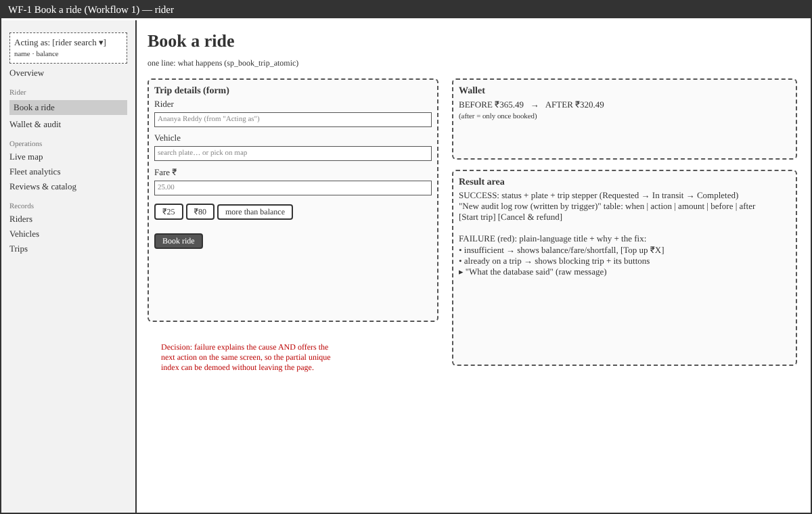
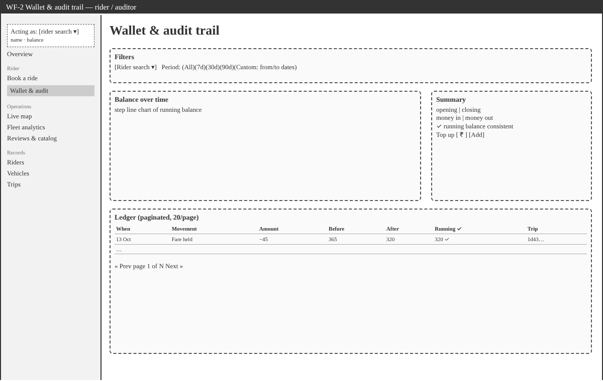
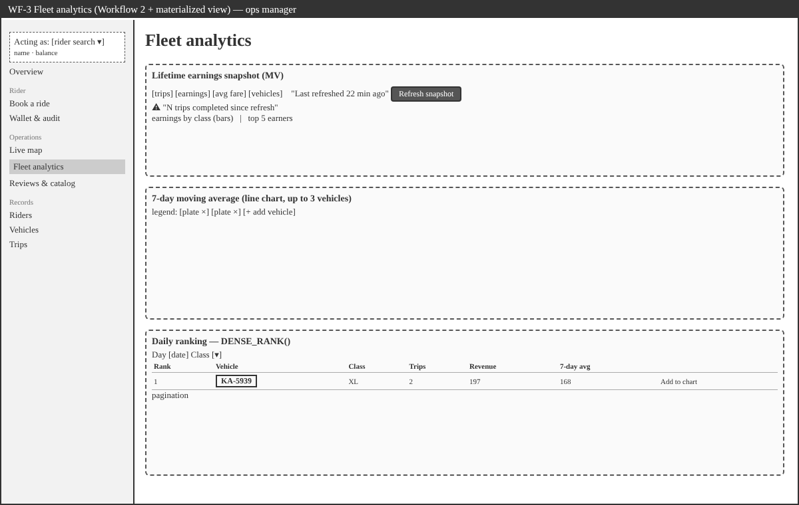
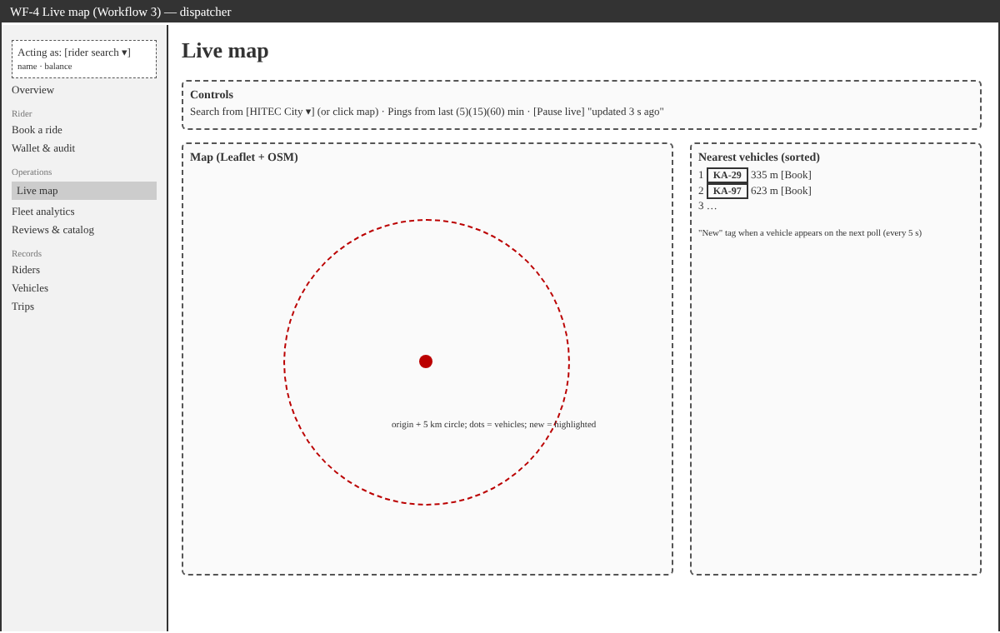
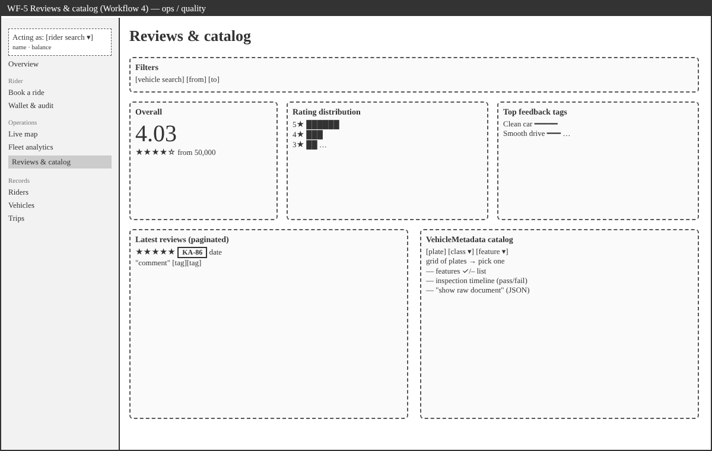
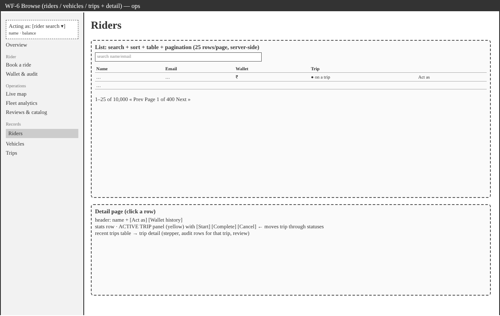
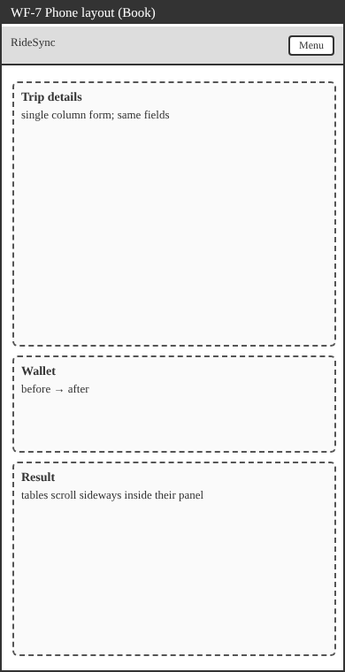

# Design

- [users.md](users.md): who uses the app and what each screen is for
- [style_guide.md](style_guide.md): colours, type, components, layout rules
- `wireframes/`: low-fidelity wireframes drawn before building (source: `wireframes/wireframes.html`, open it in a browser to edit)

| Wireframe | Screen |
|---|---|
|  | WF-1 Book a trip (Workflow 1) |
|  | WF-2 Wallet & audit trail |
|  | WF-3 Fleet analytics (Workflow 2 + MV) |
|  | WF-4 Live map (Workflow 3) |
|  | WF-5 Reviews & catalog (Workflow 4) |
|  | WF-6 Browse lists + detail pages |
|  | WF-7 Phone layout |

## Decisions the wireframes fixed early

1. **Failure is a first-class state on the booking screen.** The result area has a success layout and a failure layout. The failure layout always includes the way out (top up, or finish/cancel the blocking trip), so the partial unique index can be shown twice in a row.
2. **The rider is a global choice** ("Acting as" in the sidebar), not a field re-entered on every screen.
3. **Map and list side by side.** The list is the accessible version of the map, and both are sorted by distance.
4. **Analytics reads top to bottom from slow to live:** snapshot (materialized view) → trend (moving average) → today's ranking.
